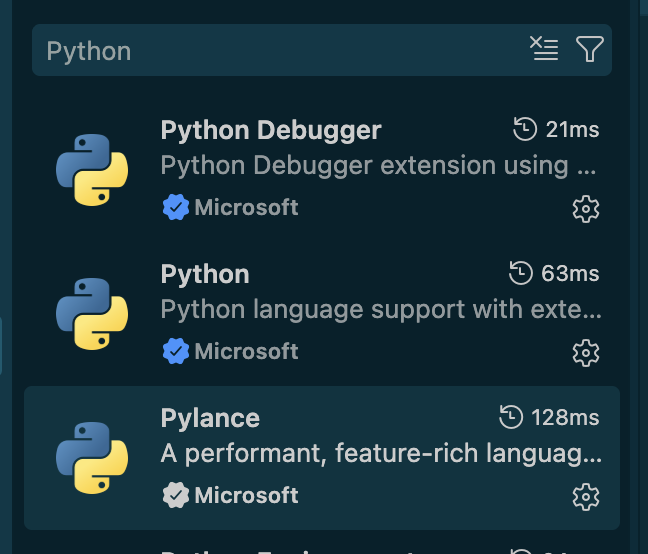
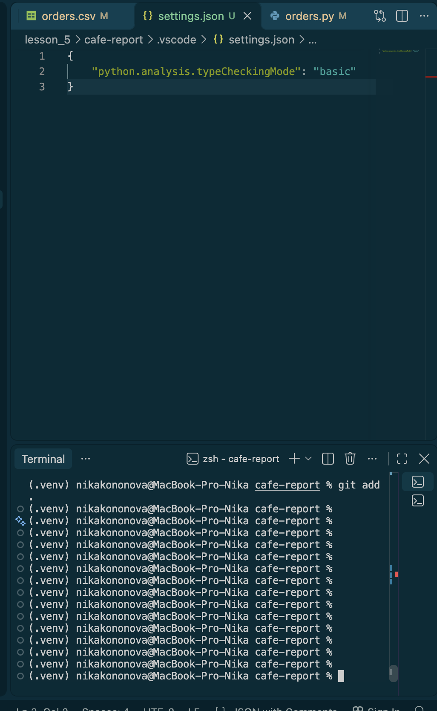
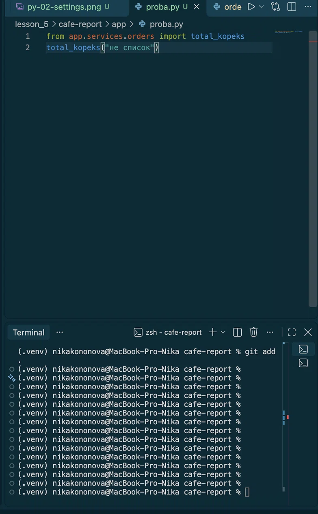
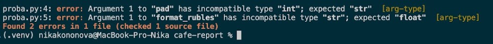
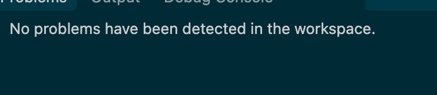
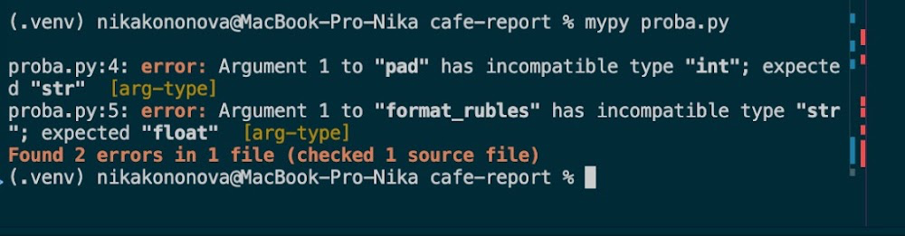
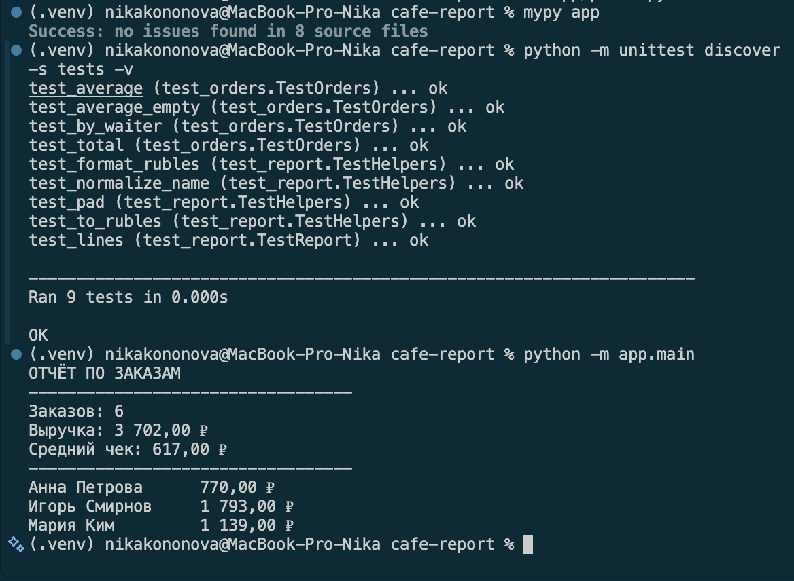

# Отчёт · Проверка типов: Pylance и mypy

**Студент:** Кононова Ника 
**Группа:** РПО№

## 1. Подготовка





## 2. Проверка в редакторе

```python
from app.utils.text import pad
from app.utils.money import format_rubles

title = pad(40, 40)
price = format_rubles("1250")
```





Разбор сообщения:

| Часть сообщения | Что означает |
|---|---|
| **Argument 1 to "pad" has incompatible type "int"; expected "str"** | Первый переданный аргумент в функцию `pad` является целым числом (`int`), хотя функция строго ожидает строку (`str`). |
| **Argument 1 to "format_rubles" has incompatible type "str"; expected "float"** | В функцию `format_rubles` передана текстовая строка `"1250"`, хотя согласно аннотации типа там должно быть число с плавающей точкой (`float`). |
| **[arg-type]** | Имя конкретного правила статического анализатора (mypy), зафиксировавшего ошибку несоответствия типов аргументов. |



## 3. Проверка в терминале

```text
proba.py:4: error: Argument 1 to "pad" has incompatible type "int"; expected "str"  [arg-type]
proba.py:5: error: Argument 1 to "format_rubles" has incompatible type "str"; expected "float"  [arg-type]
Found 2 errors in 1 file (checked 1 source file)
```



```text
Success: no issues found in 1 source file
```

## 4. Проект без аннотаций

| Этап | Итог `mypy app` |
|---|---|
| исходно | Found 17 errors in 10 files |
| после `utils` | Found 12 errors in 7 files |
| после `domain` | Found 8 errors in 5 files |
| после `services` | Found 1 error in 1 file |
| после `ui` | Success: no issues found in 8 source files |

Модуль до и после — `app/services/orders.py`:

```python
def load_orders(path):
def total_kopeks(orders):
def average_kopeks(orders):
def kopeks_by_waiter(orders):
```

```python
from pathlib import Path

def load_orders(path: Path) -> list[dict]:
def total_kopeks(orders: list[dict]) -> int:
def average_kopeks(orders: list[dict]) -> float:
def kopeks_by_waiter(orders: list[dict]) -> dict:
```

```text
(.venv) cafe-report % mypy app
Success: no issues found in 8 source files

(.venv) cafe-report % python -m unittest discover -s tests -v
test_average (test_orders.TestOrders) ... ok
test_average_empty (test_orders.TestOrders) ... ok
test_by_waiter (test_orders.TestOrders) ... ok
test_total (test_orders.TestOrders) ... ok
test_format_rubles (test_report.TestHelpers) ... ok
test_normalize_name (test_report.TestHelpers) ... ok
test_pad (test_report.TestHelpers) ... ok
test_to_rubles (test_report.TestHelpers) ... ok
test_lines (test_report.TestReport) ... ok
----------------------------------------------------------------------
Ran 9 tests in 0.000s
OK

(.venv) cafe-report % python -m app.main
ОТЧЁТ ПО ЗАКАЗАМ
----------------------------------
Заказов: 9
Выручка: 4 937,50 ₽
Средний чек: 548,61 ₽
----------------------------------
Анна Петрова      1 895,00 ₽
Игорь Смирнов     1 903,50 ₽
Мария Ким         1 139,00 ₽
```



## 5. Выводы

В ходе работы я  разобралась, как работают инструменты для проверки типов в Python (с использование расширения Pylance) и консольной утилиты mypy.
- Pylance и mypy — помощники, которые ещё до запуска программы проверяют, правильно ли мы используем типы данных (не складываем ли  число с текстом). 
Это помогает находить ошибки заранее.
- mypy: по умолчанию он ге трогает функций, у которых вообще не указаны типы данных. Чтобы он проверял абсолютно весь код, нужно специально включить строгий режим в настройках.
Эти инструменты не найдут логические ошибки (если умножили не те числа) и не проверят, правильные ли данные пришли из внешнего файла. Они следят только за «формой» данных, а не за смыслом действий.